<h1>JASPER JOHN ADRADA.</h1>

`SOFTWARE DEVELOPER / COMPUTER SCIENCE`

Building things that make sense.

---

### `01 / SELECTED WORK`

**001 &nbsp; [RESEARCH ETHICS REVIEW PORTAL ↗](https://github.com/kysokyhuh/rerc-review-portal)**  
TypeScript · Research review workflows

**002 &nbsp; [LITTLE RED RIDING HOOD ↗](https://github.com/kysokyhuh/little-red-riding-hood)**  
C · Agent simulation · Algorithms

**003 &nbsp; [ARROWS EXPRESS ↗](https://github.com/kysokyhuh/ArrowsExpress)**  
C · Console application · System logic

---

### `02 / ACTIVITY`

<picture>
  <source
    media="(prefers-color-scheme: dark)"
    srcset="./assets/contributions-dark.svg"
  >
  <source
    media="(prefers-color-scheme: light)"
    srcset="./assets/contributions-light.svg"
  >
  
</picture>

---

### `03 / TOOLKIT`

LANGUAGES

  &nbsp;&nbsp;
  &nbsp;&nbsp;
  &nbsp;&nbsp;
  

FRAMEWORKS & RUNTIME

  &nbsp;&nbsp;
  &nbsp;&nbsp;
  &nbsp;&nbsp;
  

DATABASES & TOOLS

  &nbsp;&nbsp;
  &nbsp;&nbsp;
  &nbsp;&nbsp;
  

---

### `04 / CONNECT`

[GitHub ↗](https://github.com/kysokyhuh) &nbsp; / &nbsp; [LinkedIn ↗](https://www.linkedin.com/in/jasperadrada/) &nbsp; / &nbsp; [Email ↗](mailto:kysokyhuh@gmail.com)

© Jasper Adrada · 2026
